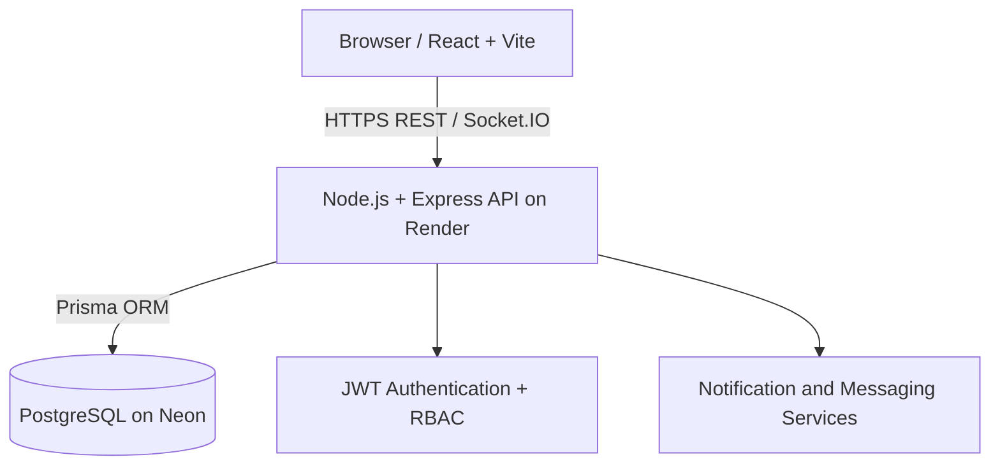
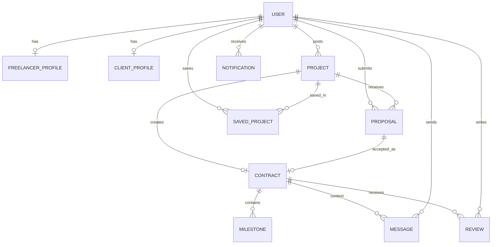
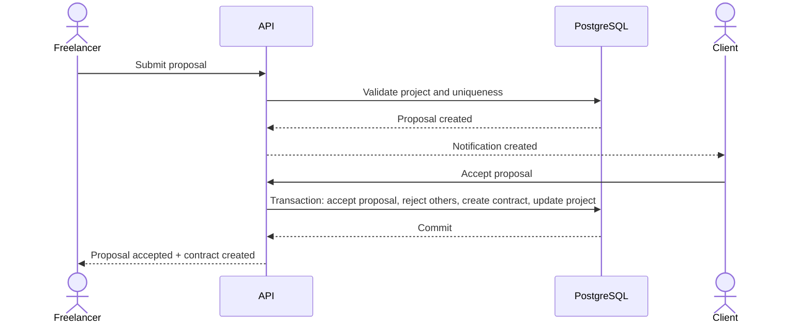
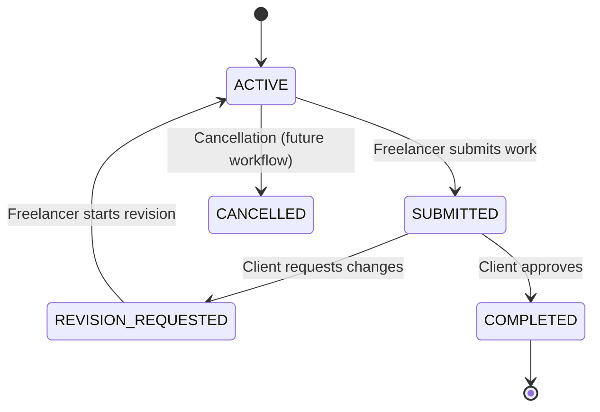

# FreelanceHub – Architecture and Design Notes

## 1. Architecture

FreelanceHub uses a three-tier web architecture:

## 2. Main modules

- Authentication and authorization
- User profile management
- Project marketplace
- Proposal and hiring workflow
- Contract and milestone management
- Messaging and notifications
- Reviews and reputation
- Administration and dispute oversight

## 3. Key entities

## 4. Proposal-to-contract sequence

## 5. Contract state model

## 6. Security design

1. Passwords are hashed with bcrypt before storage.
2. Login issues a signed JWT; protected API requests use the Bearer token.
3. Authentication middleware resolves the current database user and checks account activity.
4. Role middleware restricts role-specific APIs.
5. Resource ownership is checked in each project, proposal, contract and message operation.
6. Admin is not a public registration option; the seed process creates an administrator.
7. Helmet, CORS allow-listing and API rate limits provide baseline HTTP protections.

## 7. Deployment design

- React static assets are deployed as a Render Static Site.
- Express + Socket.IO is deployed as a Render Web Service.
- PostgreSQL runs on Neon.
- Environment variables store database URLs, JWT secret and deployment origins.
- The frontend uses the `VITE_API_URL` and `VITE_SOCKET_URL` build-time variables.
